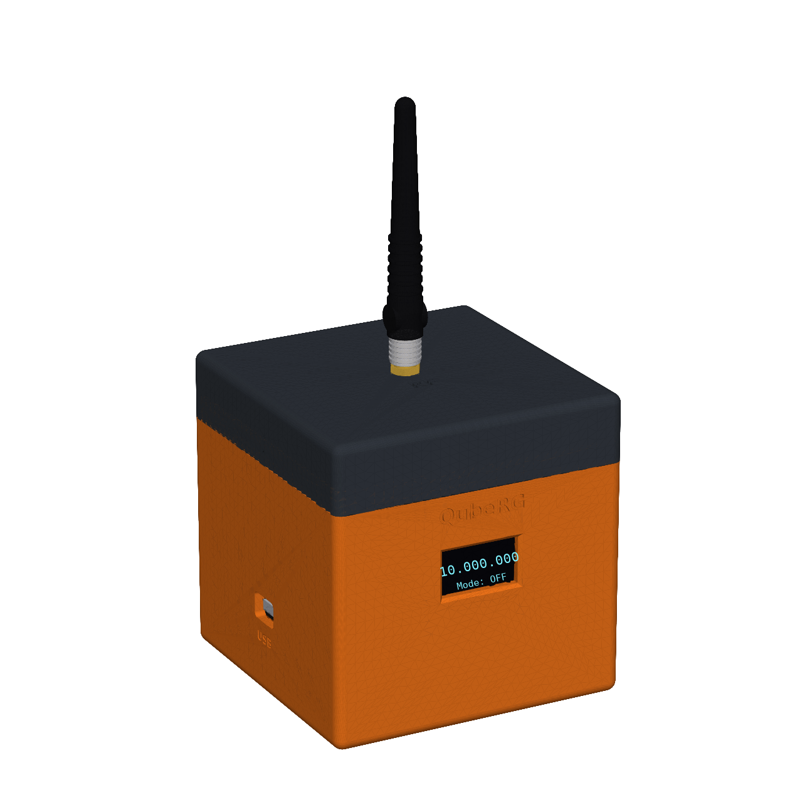
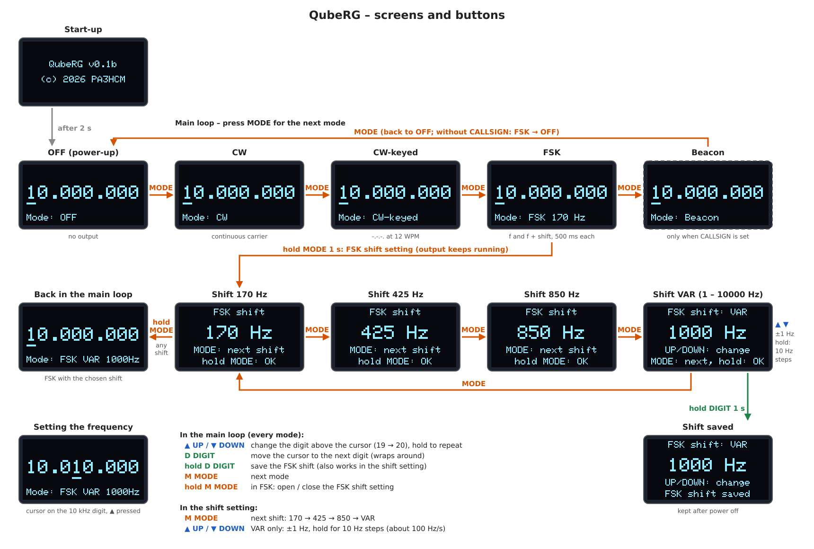
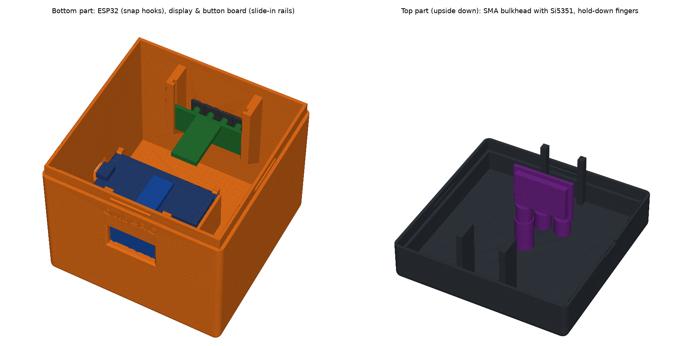
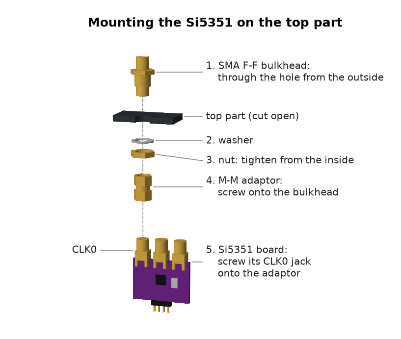

# QubeRG v0.1b



**QubeRG** is a small, self-contained RF signal generator for the radio
amateur's workbench. It fits in a 3D-printed 90 mm cube: the frequency is on
the display at the front, four buttons are on the back, the RF output is an
SMA connector on top, and a USB cable powers the whole unit.

Inside, an ESP32 controls an Si5351 clock generator. You can set any
frequency from 8 kHz to 99.999.999 Hz in 1 Hz steps, digit by digit, and
choose what the output sends: a plain carrier, keyed CW, a signal that
shifts between two frequencies (1 Hz to 10 kHz apart), or a CW beacon with
your own callsign.

### What can you do with it?

- **Check and calibrate receivers and SDRs:** is the dial or waterfall on
  the right frequency, and does the S-meter react as expected?
- **Test CW decoders and receivers:** with a known keyed carrier.
- **Check FSK setups and receiver behaviour:** the RTTY shifts 170, 425 and
  850 Hz, or any shift from 1 Hz to 10 kHz, for decoders' tuning
  indicators, AFC, filters and panadapters.
- **Run a small beacon:** for propagation tests, antenna pattern
  measurements or fox-hunting practice. You need a licence and must stay
  within your licence's frequencies and power.
- **Use it as a clock source:** for digital circuits and experiments.

The Si5351 outputs a square wave, which is rich in harmonics. Use a low-pass
filter when you need a clean signal, and an attenuator when you connect it
to a sensitive receiver.

### Why "QubeRG"?

The name combines the shape and the purpose of the device:

- **Qube** – it is a cube.
- **QRG** – the Q-code for frequency ("QRG?" = *What is my exact frequency?*).
  Q-ube-RG contains the letters of QRG, and setting an exact frequency is
  exactly what the device does.

<br clear="right">


## Wiring (all 3.3 V)

| ESP32   | Si5351 | OLED (GM009605v4) | Buttons |
|---------|--------|-------------------|---------|
| 3V3     | VIN    | VCC               |         |
| GND     | GND    | GND               | GND     |
| GPIO21  | SDA    | SDA               |         |
| GPIO22  | SCL    | SCL               |         |
| GPIO32  |        |                   | K1      |
| GPIO33  |        |                   | K2      |
| GPIO25  |        |                   | K3      |
| GPIO26  |        |                   | K4      |

RF output: Si5351 **CLK0** SMA connector.

## Operation

The display shows the frequency in Hz as `10.000.000` (10 MHz at start-up),
with a cursor below the selected digit.



The screens in this diagram are rendered from the real firmware code
(`tools/screenflow/build.sh`).

| Button | Press | Hold 1 second |
|--------|-------|---------------|
| 1 ▲ UP | Increase selected digit (carries over: 19 → 20) | Repeat |
| 2 ▼ DOWN | Decrease selected digit (borrows: 20 → 19) | Repeat |
| 3 D DIGIT | Select next digit to the right; wraps from last to first | Save the FSK shift |
| 4 M MODE | Select next mode (see below) | In `FSK`: open the FSK shift setting |

The bottom line of the display shows `Mode: ` and the active mode, for
example `Mode: FSK 170 Hz` or `Mode: FSK VAR 1000Hz`.

| Mode | Output on CLK0 |
|------|----------------|
| `CW` | Continuous carrier |
| `CW-keyed` | Keyed carrier `-.-.-.` … (100 ms dot, 300 ms dash, 12 WPM) |
| `FSK` | Alternates between f and f + shift at 1 Hz (500 ms each) |
| `Beacon` | Callsign in morse (12 WPM), then a 60 second carrier, repeated |
| `OFF` (default) | No output |

After `OFF` the mode wraps back to `CW`. The frequency can still be changed in every mode.

**FSK shift:** in `FSK` mode, hold MODE for 1 second to open the shift
setting. The output keeps running, so you can hear or see the change.

| Button | In the shift setting |
|--------|----------------------|
| MODE (press) | Next shift: 170 → 425 → 850 → VAR → 170 |
| UP / DOWN | `VAR` only: shift +/- 1 Hz. Hold for 10 Hz steps (about 100 Hz per second). Range 1 – 10000 Hz, starting at 1000 Hz. |
| DIGIT (hold) | Save the shift (preset or VAR value) |
| MODE (hold) | Back to normal operation |

The shift is stored in the ESP32 `Preferences` memory, so it survives a reboot
or power cut. Holding DIGIT also saves it during normal operation.

**Beacon:** the `Beacon` mode is only available after you set your own
callsign. Change this line in `src/main.cpp` and upload the firmware again:

```cpp
static const char *const CALLSIGN = "N0CALL";
```

With the default `N0CALL`, button 4 skips the `Beacon` mode. The callsign may
contain A–Z, 0–9 and `/`. The length of the carrier is set by
`BEACON_CARRIER_MS` (60000 ms).

Range: 8 kHz … 99.999.999 Hz. Steps that would leave the range are ignored.

## Case

The `case/` folder holds a 3D-printable cube case (FDM, PETG):

| File | Part | Print orientation |
|------|------|-------------------|
| `case/stl/qube_bottom.stl` | Floor + 4 walls (display window, USB hole, button holes) | As is, floor on the bed |
| `case/stl/qube_top.stl` | Lid with SMA hole and hold-down fingers | As is (already upside down) |
| `case/stl/qube_buttons.stl` | 4 button caps | As is, flange on the bed |



- **Two halves that click together:** the bottom part has a tongue with snap ridges, the top part slides over it. Use the notch on the right side to pry it open.
- **ESP32:** lies on the bottom, component side up, header pins pointing down (room for dupont plugs). It clicks between 4 flexible hooks; the USB connector lines up with the hole in the left wall.
- **Display:** slides into rails on the inside of the front wall, glass against the window.
- **Button board** (38 × 16 mm, 7.3 mm button spacing): switches facing the back wall, slides into rails on the back wall. Put the 4 caps in the holes from the inside first, with the long side of the flange vertical.
- **Locking:** fingers on the lid press the display and button board down when the cube is closed.
- **Buttons marked** ▲ ▼ D M (up, down, Digit, Mode) on the back.
- **Si5351:** hangs from the lid, parallel to the front wall, right above the ESP32. Mount the SMA F-F bulkhead in the centre hole of the top, screw the M-M adaptor into it and the Si5351 CLK0 jack onto the adaptor:



Suggested print settings: PETG, 0.2 mm layers, 3 walls, 20 % infill, no supports.

**Measure your boards before printing.** Board sizes differ between suppliers. All dimensions are parameters at the top of `case/qube_case.py`. After changing them, regenerate the STLs and run the fit check against dummy boards:

```bash
pip install manifold3d numpy matplotlib
cd case && python3 qube_case.py --check --preview
```

**SMA hole in the top:** SMA bulkhead connectors come in different sizes, and
many have two flat sides so they can't turn. The hole is made for a connector
of 7.8 mm diameter with 7.4 mm across the flats, plus 0.2 mm clearance
(so the hole is 8.0 × 7.6 mm). For another connector, measure it and
regenerate only the top part:

```bash
cd case && python3 qube_case.py --only top --sma-d 7.8 --sma-flats 7.4
```

Use `--sma-flats 0` for a round hole, `--sma-clear` for more or less
clearance, and `--sma-angle` to rotate the flats. The defaults are at the top
of `case/qube_case.py` (`SMA_HOLE_D`, `SMA_HOLE_FLATS`, `SMA_HOLE_CLEAR`,
`SMA_HOLE_ANGLE`).

## Build & upload

Open the `QubeRG` folder in VS Code with the PlatformIO extension, then
**Build** and **Upload** (environment `esp32dev`). Libraries are fetched
automatically.

## Calibration

Set `XTAL_CORRECTION` in `src/main.cpp` (parts per billion) to correct the
25 MHz crystal error.

## License

(c) 2026 PA3HCM

This work is licensed under the
[Creative Commons Attribution-NonCommercial 4.0 International License](https://creativecommons.org/licenses/by-nc/4.0/)
(CC BY-NC 4.0). You may share and adapt it for non-commercial purposes,
provided you give appropriate credit. See [LICENSE](LICENSE) for the full text.
